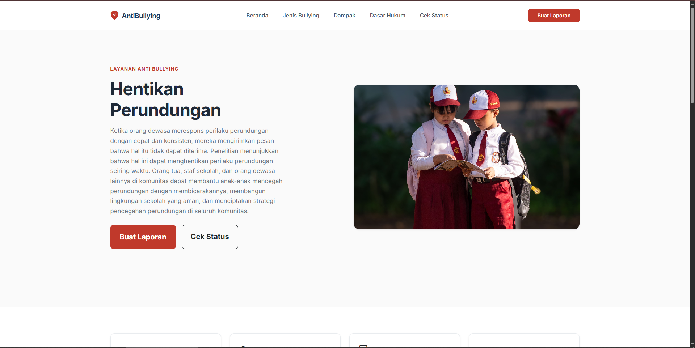

<div>
  
</div>
# 🛡️ Sistem Pelaporan Anti-Bullying Sekolah

Website sistem informasi pelaporan tindakan perundungan (*bullying*) di lingkungan sekolah. Proyek ini dikembangkan untuk menyediakan sarana pelaporan yang aman, anonim, dan rahasia bagi siswa, sekaligus membantu Guru Bimbingan Konseling (BK) dalam mengelola serta menindaklanjuti laporan.

Sistem ini juga menyediakan informasi edukatif mengenai bullying, dampaknya, serta dasar hukum yang berlaku di Indonesia.

## ✨ Fitur Utama

- **Pelaporan Anonim**  
  Siswa dapat menyampaikan laporan tanpa harus mencantumkan identitas pribadi.

- **Kode Tracking Laporan**  
  Setiap laporan mendapatkan kode unik yang dapat digunakan untuk memantau perkembangan penanganan laporan.

- **Manajemen Laporan Admin**  
  Panel khusus Guru BK untuk melihat detail laporan dan memperbarui status penanganan:
  - Diterima
  - Diproses
  - Selesai

- **Angket Nasional**  
  Formulir survei untuk membantu memetakan kondisi dan kasus bullying di lingkungan sekolah.

- **Edukasi dan Informasi Hukum**  
  Menyediakan informasi mengenai jenis-jenis bullying, dampak yang ditimbulkan, serta dasar hukum terkait perundungan di Indonesia.

- **Desain Responsif**  
  Antarmuka yang dirancang agar dapat digunakan melalui berbagai perangkat, baik komputer maupun smartphone.

## 🛠️ Teknologi yang Digunakan

| Teknologi | Keterangan |
|---|---|
| HTML5 | Struktur halaman website |
| CSS3 | Styling dan tata letak |
| Bootstrap 5 | Framework antarmuka |
| JavaScript | Interaksi pada sisi frontend |
| PHP 8 | Backend menggunakan PHP Native |
| MySQL | Sistem manajemen database |
| PDO | Koneksi dan interaksi database |
| Bootstrap Icons | Ikon antarmuka |
| Google Fonts (Inter) | Tipografi website |

## ⚙️ Instalasi dan Konfigurasi

Ikuti langkah-langkah berikut untuk menjalankan proyek secara lokal.

### 1. Persiapan

Pastikan perangkat sudah memiliki:
- [XAMPP](https://www.apachefriends.org/)
- PHP 8 atau versi yang kompatibel
- MySQL
- Web Browser

### 2. Clone Repository

Buka terminal atau Command Prompt, kemudian jalankan:

```bash
git clone https://github.com/qanziz47-coder/website-anti-bullying.git
```

### 3. Pindahkan Folder Proyek

Pindahkan folder hasil clone ke direktori `htdocs` milik XAMPP.

Contoh:

```text
C:\xampp\htdocs\anti_bully
```

### 4. Konfigurasi Database

1. Jalankan Apache dan MySQL melalui XAMPP Control Panel.
2. Buka phpMyAdmin melalui browser:

   `http://localhost/phpmyadmin`

3. Buat database baru dengan nama:

   `anti_bully`

4. Pilih database tersebut.
5. Import file `anti_bully.sql` yang tersedia di folder proyek.

### 5. Konfigurasi Koneksi Database

Buka file `config/db.php`, kemudian sesuaikan konfigurasi database dengan pengaturan MySQL lokal:

```php
$host = 'localhost';
$db   = 'anti_bully';
$user = 'root';
$pass = ''; // Sesuaikan dengan password MySQL
```

Pastikan konfigurasi PDO pada file tersebut menggunakan kredensial yang sesuai.

### 6. Jalankan Website

Setelah seluruh konfigurasi selesai, buka browser dan akses:

```text
http://localhost/anti_bully/
```

Website sekarang dapat dijalankan melalui localhost.

## 📁 Struktur Folder

```text
anti_bully/
│
├── admin/              # Panel administrasi Guru BK
│
├── assets/             # File gambar, CSS, JavaScript, dan aset lainnya
│
├── config/             # Konfigurasi aplikasi dan database
│   └── db.php          # Koneksi database
│
├── page/               # Halaman informasi dan edukasi
│
├── partials/            # Komponen website yang digunakan berulang
│
├── uploads/             # Penyimpanan file bukti laporan
│
├── index.php            # Halaman utama
├── lapor.php            # Formulir pelaporan bullying
├── cek_status.php       # Halaman pengecekan status laporan
├── angket.php           # Halaman angket
│
└── anti_bully.sql       # File database
```

## 👨‍💻 Pengembang

**Fajri (hafzdev)**

- **Status:** Siswa SMK
- **Jurusan:** Rekayasa Perangkat Lunak (RPL)
- **Portfolio:** [hafzdev.web.id](https://www.hafzdev.web.id/)

## 🎯 Tujuan Pengembangan

Proyek ini dikembangkan sebagai bagian dari pembelajaran dan penerapan ilmu Rekayasa Perangkat Lunak, khususnya dalam pengembangan aplikasi berbasis web menggunakan PHP dan MySQL.

Selain sebagai proyek pembelajaran, website ini diharapkan dapat menjadi salah satu sarana pendukung dalam menciptakan lingkungan sekolah yang lebih aman, nyaman, dan bebas dari perundungan.

---

<p align="center">
  <b>🛡️ Bersama Ciptakan Lingkungan Sekolah Bebas Bullying.</b>
  <br>
  <i>Berani Melapor, Berani Peduli.</i>
</p>
